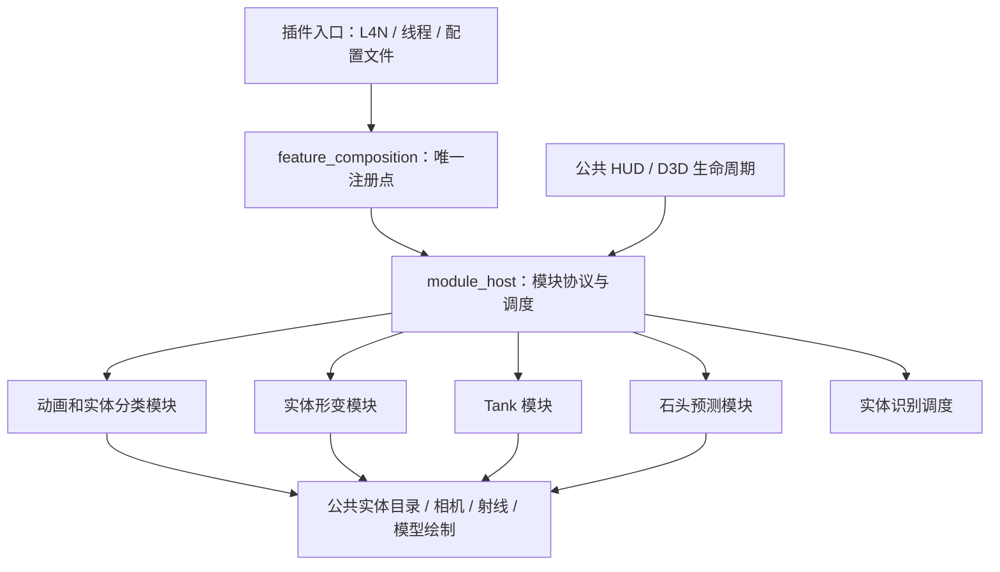

# 模块接入层

每个功能通过 `Module` 声明页面、动作、根菜单入口、配置读写、采集需求、
帧回调、后台任务、覆盖层及退出恢复。`plugin.cpp` 不导入具体功能，HUD
不引用 Tank/石头等实现；具体功能的注册和模型回调转接仅在 composition。
移除某个功能注册后，其菜单、配置、采集需求、后台任务和覆盖层自然退出调度。
适配器互不包含对方的模块文件；架构检查脚本在测试入口中执行。

## 顺序与线程

注册在创建后台线程前完成并冻结，运行中不增删。游戏帧先合并采集需求，
只采集一次，再按识别、形变、Tank、石头、动画顺序更新；菜单展示顺序单独定义。
每个模块的 `pollInterval` 合并为最短间隔，配置仍在原后台线程保存。
D3D 覆盖层仍在原呈现回调中绘制，背缓冲备份/恢复及重置逻辑不变。
模型观察者统一广播，骨骼变形按注册顺序由第一个成功处理的模块负责，避免重复变形。

退出先 `quiesce`，反向请求恢复并关闭观察/变形接入；游戏帧回调在此期间
仍可运行，以便实体字段和描边完成恢复。随后停止后台线程，反向 `stop`，
最后释放公共 HUD、渲染钩子和相机。恢复请求和 stop 均幂等。

## 状态与边界

动画开关、识别菜单和目标选择缓存归入动画模块的 Runtime 实例，由注册
持有其生命周期；不再是插件入口的散落变量。通知和保存请求由 UI 服务统一管理。
其他功能的既有算法状态仍在各自实现命名空间内，适配器负责其接入和清理。
公共渲染参数、实体目录和相机快照仍是共享服务，并非每个功能都独立复制。

本轮是接入层解耦，不宣称完成所有历史实现的私有化或多 DLL 动态插件化。
算法、配置键、菜单 ID、L4N ABI 均保留，未重新引入喷漆功能。
下一步可逐个将剩余功能内部状态迁入 Runtime 类，并在稳定接口后拆分编译单元。

## 本轮验证

25 个测试程序执行通过，包含模块注册/唯一性/冻结、需求合并、帧顺序、
配置与菜单独立分发、删除模块注册、观察者广播、骨骼修改归属、异常覆盖层隔离、
实例状态生命周期、退出恢复帧可继续执行及重复停止。已有算法与默认配置回归保留。
所有适配器和公共 HUD 已分别进行独立头文件 x86 语法检查，避免依赖包含顺序。
另验证 x86 DLL 构建和安装包布局；不代替游戏内并发、切图与退出实机验收。

## 第一人称身体与日志整合

第一人称身体由 `src/modules/first_person_body_module.hpp` 注册，管理菜单、配置、游戏帧、
原生绘制门控及退出 Hook 恢复。模块不引入喷漆功能，也不直接与 Tank 或形变模块互相包含。
公共 `source_render.hpp` 只定义 `StudioDecorator` 的中立绘制回调；它在原有
`modifyPose` 处理后、最终 `studioOriginal` 调用前执行，保持一次原始绘制。
`feature_composition.hpp` 将注册的模块适配到此回调。

`logging.level` 为公共服务设置，默认 `info`。后台线程只有在 Debug 开启时才生成
周期性接口、实体和绘制统计快照，普通错误与事件日志仍保存。
「实体缩放与拉伸」中的「邦友的酒」只是菜单导航关系，两个运行模块保持独立。

这次只做接入层整合，尚未将所有历史算法封装为 Runtime 类。
